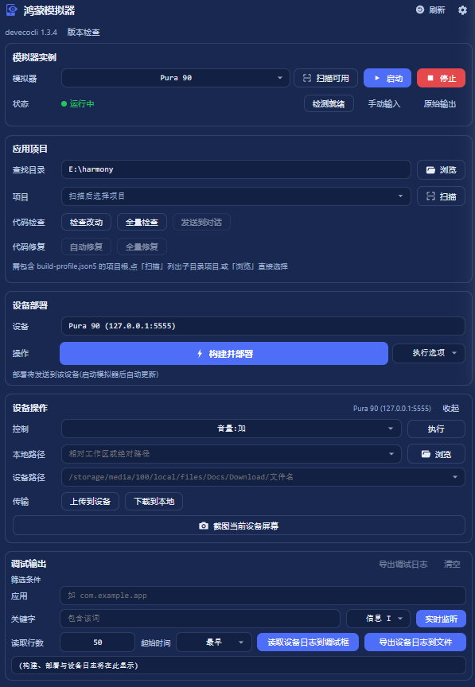

# 鸿蒙模拟器 · dsh-hmos-emulator

> DeepSeek Harness 侧边栏插件：在面板中启动鸿蒙模拟器，并把选定的 HarmonyOS 应用构建、部署到模拟器。



## 能做什么

- **模拟器实例**：扫描、启动与停止鸿蒙模拟器，也可手动填写实例名或串号。
- **应用项目**：浏览或扫描工作区识别鸿蒙工程，并记住每个工程的入口模块。
- **设备部署**：构建、安装并启动到目标设备，也可只构建、只部署或清理构建产物。
- **部署实时输出**：构建、安装与启动过程边跑边显示。
- **就绪检测**：模拟器冷启动后检测设备是否上线。
- **代码检查与修复**：调用 DevEco 的 Code Linter，可只检查改动或全量检查，并按同一范围自动修复。
- **设备控制**：旋转、电源、音量、电量、定位与摇一摇作用于所选设备。
- **设备文件收发**：与运行中的设备互传单个文件。两个路径都能手输，也能从最近用过的路径中挑选；下载的文件默认保存在工作区。
- **设备截图**：截取当前屏幕并保存到工作区的 `screenshots/` 目录，面板底部可回看最近一张。
- **设备日志**：按条件读取一次设备日志并显示在调试框中，或直接从设备取一份保存为文本文件，也可实时监听设备日志。
- **调试日志导出**：把调试框中的内容保存为文本文件，保存位置每次自选。

面板自上而下依次是「模拟器实例」「应用项目」「设备部署」「设备操作」「调试输出」，截图之后下方还会出现「最近截图」，同类操作集中在同一张卡里。

## 安装

安装本插件前需要准备以下环境。

- 已安装 dsh 并正常运行（`dsh web`）；Node.js ≥ 22（LTS 或更新）、pnpm ≥ 10。
- 已安装 [DevEco Studio](https://developer.huawei.com/consumer/cn/download/)（提供模拟器、hdc 与 SDK）；Linux 上改用 [Command Line Tools](https://developer.huawei.com/consumer/cn/download/)（见「平台支持」）。
- 已安装 [`devecocli`](https://www.npmjs.com/package/@deveco/deveco-cli) 命令行工具；如未安装，执行 `npm i -g @deveco/deveco-cli`，或安装本插件后在面板中点击「一键安装 devecocli」。

### 方式一：npm 安装（推荐）

```sh
dsh plugin --profile web add dsh-hmos-emulator
```

### 方式二：从 GitHub 安装（免 npm）

```sh
dsh plugin --profile web add github:momo20012002/dsh-hmos-emulator
```

### 方式三：本地挂载（开发）

```sh
git clone https://github.com/momo20012002/dsh-hmos-emulator.git
cd dsh-hmos-emulator && pnpm install && pnpm build
dsh plugin --profile web add .
```

安装完成后，重启 `dsh web`，再刷新浏览器页面，即可生效。

卸载：

```sh
dsh plugin --profile web remove dsh-hmos-emulator
```

## 使用

1. 打开右侧栏的「＋」菜单 →「鸿蒙模拟器」。
2. 点击「扫描可用」列出模拟器与在线设备，再点击「启动」。
3. 在「应用项目」中浏览或扫描，选择鸿蒙工程。
4. 在「操作」行选择命令（构建并部署 / 构建 / 部署 / 清理构建），点击执行。
5. 需要看日志时，在「调试输出」中按条件读取一次，或打开实时监听。

## 设置

插件提供以下设置项，可在面板右上角的「设置」中修改。

- **挂载方式**：选择面板的显示位置 —— 内置右侧栏（默认）或 `better-sidebar`。
  - 未安装 [dsh-better-sidebar](https://github.com/omdsh-dev/DSH-better-sidebar) 时，该选项置灰，无法切换。
  - 切换后原标签页关闭，面板在新位置打开。
  - 若未自动打开，可在右侧栏的「＋」菜单中重新选择「鸿蒙模拟器」。
- **devecocli 更新通道**：选择「版本检查」所使用的发布通道 —— `stable`（厂商稳定通道）或 `latest`（最新发布通道）。未选择时跟随当前已安装的通道。

## 模型工具

除面板外，插件向 AI 提供以下工具，可在对话中直接触发模拟器、部署、日志、代码检查等操作。

| 工具 | 职责 |
|---|---|
| `emu` | 模拟器实例的查看、启动与停止，以及设备控制（旋转、电源、音量、电量、定位、摇一摇） |
| `emu_ui` | 读取屏幕结构、点击与输入、滑动与拖拽，以及截图 |
| `hmos_deploy` | 构建 → 安装 → 启动；可只构建指定模块，或清理构建产物 |
| `hmos_device` | 查看设备详情、与设备互传文件、对设备上的 SQLite 数据库执行语句 |
| `hmos_lint` | 运行 DevEco 代码检查，可只查改动或查全量（自动修复在面板里做） |
| `hmos_log` | 读取设备日志，可按级别、应用、关键字与时间范围筛选 |
| `hmos_docs` | 检索并阅读官方鸿蒙文档 |

- 界面状态默认以节点结构读取，截图仅用于节点结构无法说明的场景（白屏、崩溃、视觉问题）。
- 出现异常时，插件会自动把截图留存到工作区 `screenshots/` 目录。
- 截图可与上一张比对：画面无变化时不写入新图。

## 平台支持

- **Windows / macOS**：模拟器启动与停止由 [DevEco Studio](https://developer.huawei.com/consumer/cn/download/) 提供。
- **Linux**：DevEco Studio 没有 Linux 版，模拟器来自 [Command Line Tools](https://developer.huawei.com/consumer/cn/download/)（需 26.0.0 Release 及以上）。需要：
  - Ubuntu 18.04 及以上；
  - 把 `DEVECO_CLI_CLT_PATH` 指向 Command Line Tools 安装目录（或把其 `emulator` 目录加入 `PATH`）；
  - 需要桌面环境：无图形界面（`DISPLAY` / `WAYLAND_DISPLAY` 均未设置）时，本插件不提供启动支持。
- 选择工程、连接设备、构建并部署在所有系统上均可用。

## 常见问题

| 现象 | 处理 |
|---|---|
| 启动时提示授权 / 协议未接受 | 在终端执行 `devecocli emulator license accept` 后重试 |
| 扫描不到模拟器实例 | 使用 DevEco Studio 的 Device Manager 确认实例存在，或在终端执行 `devecocli emulator list` 查看实际报错 |
| Linux 上启动模拟器报错 | 需 Command Line Tools 26.0.0 Release 及以上（`DevEco Studio is not available on Linux` 即未设置 `DEVECO_CLI_CLT_PATH`） |
| 部署失败但无具体报错 | 在工程中配置签名后重试。多入口模块已自动选择入口模块，可在面板切换。 |
| 提示找不到 hdc | 设置环境变量 `DEVECO_SDK_HOME` 指向 DevEco Studio 的 SDK 目录，然后重启 `dsh web` |
| 读取日志或实时监听一直没有输出 | 检查「级别」是否选成了「调试」：多数设备不输出 D 级别的日志，换成「全部级别」即可 |

## License

[MIT](LICENSE)
